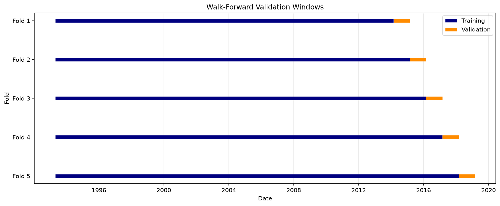
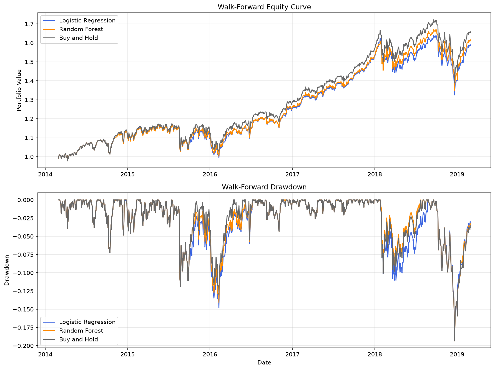
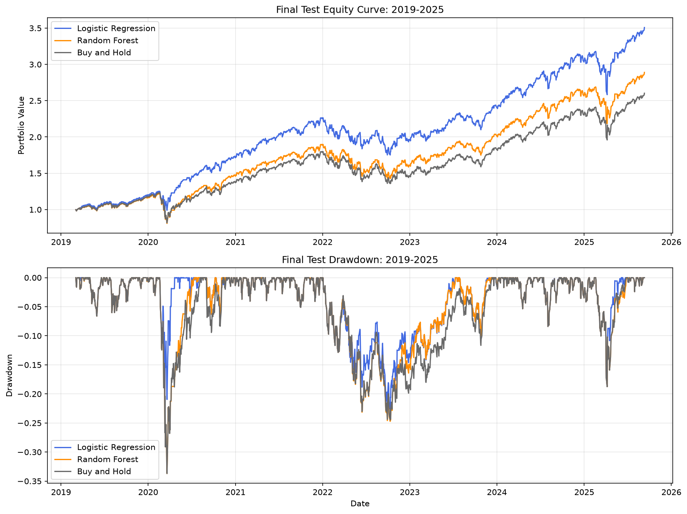

# SPY Market Timing with Machine Learning

[](https://www.python.org/)
[](LICENSE)
[](https://github.com/BolinYan38/spy-market-timing/actions/workflows/repository-checks.yml)

## 项目简介

我在这个项目中使用 SPY 历史日线数据预测下一交易日的涨跌方向，并把模型输出转换为一套简单的市场择时策略。模型预测上涨时持有 SPY，模型预测不涨时持有现金。策略不做空，不使用杠杆，每次买入或卖出均计入交易成本。

我选择逻辑回归作为线性基线模型，用它检验历史收益、趋势、波动率和成交量特征与下一日上涨概率之间的线性关系。然后使用随机森林学习非线性关系和特征交互。我通过严格的时间顺序划分和 Walk-forward 验证两种不同的方式来完成模型选择，并在独立最终测试集上比较两类模型的表现。

这个项目覆盖数据检查与分析，模型训练、样本外验证、参数选择、交易成本、策略回测、风险指标和结果解释。作为本人的初次训练项目，我们把重点放在研究流程的完整性、时间序列验证的严谨性和结果的可复现性上。

## 主要结论

- SPY 在样本中具有明显的上涨先验，始终预测上涨即可获得约 55% 的准确率。
- 两个模型的 ROC-AUC 均接近 0.5，当前特征对下一交易日方向的稳定预测能力较弱。
- 2014—2019 年 Walk-forward 连续样本外回测中，逻辑回归和随机森林的净 Sharpe Ratio 分别为 0.77 和 0.79，买入并持有为 0.83。
- 2019—2025 年最终测试中，逻辑回归净策略的累计收益为 250.78%，Sharpe Ratio 为 1.12，最大回撤为 -22.61%。
- 逻辑回归的最终测试表现主要来自少数风险退出日期，其中包含一次约 -10.94% 的下一日收益。
- 开发期 Walk-forward 结果没有复制最终测试期的收益优势。我们的模型并未拥有持续稳定的方向预测优势。
- 当前模型最大的作用，在于长期持有 SPY 基础上，进行低频风险过滤。

## 项目结构

```text
.
├── .github/
│   └── workflows/
│       └── repository-checks.yml
├── archive/
│   ├── DATA.md
│   └── spy-historical.csv          # kaggle网站数据，不纳入 Git
├── notebooks/
│   └── spy-analysis.ipynb
├── outputs/
│   └── figures/
│       ├── 01_training_adjusted_close.png
│       ├── 02_logistic_equity_drawdown.png
│       ├── 03_annual_return_comparison.png
│       ├── 04_logistic_coefficients.png
│       ├── 05_walk_forward_windows.png
│       ├── 06_walk_forward_equity_drawdown.png
│       └── 07_final_test_equity_drawdown.png
├── scripts/
│   └── validate_notebook.py
├── .gitattributes
├── .gitignore
├── .python-version
├── LICENSE
├── README.md
└── requirements.txt
```

## 数据说明

项目使用本地文件 `archive/spy-historical.csv`，该数据集来源于Kaggle网站
`https://www.kaggle.com/datasets/ambrosm/s-and-p-historical-data-for-hull-tactical-competition/data`
名为“S&P Historical Data for Hull Tactical Competition”的一项比赛。

原始数据包含 8,210 个 SPY 交易日，日期范围为 1993-02-01 至 2025-09-11。最后一个交易日没有下一日收益，因此进入建模数据的最后日期为 2025-09-10。

数据字段如下：

| 字段 | 含义 |
|---|---|
| `date_id` | 数据记录编号 |
| `Date` | 交易日期 |
| `Open` | 开盘价 |
| `High` | 最高价 |
| `Low` | 最低价 |
| `Close` | 收盘价 |
| `Adj Close` | 复权收盘价 |
| `Volume` | 成交量 |
| `Dividend` | 分红 |
| `forward_returns` | 下一交易日含分红收益率 |

原始市场数据不纳入 Git 仓库。运行项目之前，需要通过有权使用的来源取得数据，并把文件保存为：

```text
archive/spy-historical.csv
```

本项目使用的数据文件 SHA-256 校验值为：

```text
b60ef80723379c268501c6f7b80e08aa18349c867e64f5734a651a6f2135c70e
```

更多数据放置说明见 [`archive/DATA.md`](archive/DATA.md)。

## 预测目标

我使用 `forward_returns` 构造二分类目标：

```text
target = 1  当下一交易日收益率大于 0
target = 0  当下一交易日收益率小于或等于 0
```

每一行特征只使用当日收盘时及以前能够获得的信息。`forward_returns` 和 `target` 仅用于建立标签、计算评价指标和回测收益，它们不进入模型特征。

## 特征分类

模型共使用 11 个特征：

| 类别 | 特征 | 含义 |
|---|---|---|
| 历史收益 | `return_1d` | 最近 1 个交易日收益率 |
| 历史收益 | `return_5d` | 最近 5 个交易日累计收益率 |
| 历史收益 | `return_20d` | 最近 20 个交易日累计收益率 |
| 趋势 | `distance_ma_5` | 价格相对 5 日均线的距离 |
| 趋势 | `distance_ma_20` | 价格相对 20 日均线的距离 |
| 趋势 | `distance_ma_60` | 价格相对 60 日均线的距离 |
| 波动率 | `volatility_5d` | 5 日滚动收益波动率 |
| 波动率 | `volatility_20d` | 20 日滚动收益波动率 |
| 日内信息 | `intraday_return` | 收盘价相对开盘价的日内收益 |
| 日内信息 | `daily_range` | 当日最高价与最低价形成的振幅 |
| 成交量 | `volume_ratio_20d` | 成交量相对 20 日平均成交量的比例 |

滚动特征会在样本开始阶段产生缺失值。我在全部特征完成后统一删除这些记录。最终可用于模型训练和测试的数据从 1993-04-27 开始。

## 时间划分与验证方法

金融时间序列具有明确的先后关系。我始终按照日期顺序划分数据，不使用随机打乱。

### 开发集与最终测试集

| 数据集 | 日期范围 | 用途 |
|---|---|---|
| 开发集 | 1993-04-27 至 2019-03-01 | 模型训练、Walk-forward 验证和参数选择 |
| 最终测试集 | 2019-03-04 至 2025-09-10 | 模型确定后的最终样本外评估 |

最终测试集在模型和参数确定之前不参与选择过程。

### Walk-forward 验证

我在开发集中使用 5 个扩展窗口，每个验证窗口包含 252 个交易日，训练集与验证集之间保留 1 个交易日的 gap。每完成一个窗口，历史验证数据会进入下一个窗口的训练范围。

```text
1993—2013 训练 → 2014 验证
1993—2014 训练 → 2015 验证
1993—2015 训练 → 2016 验证
1993—2016 训练 → 2017 验证
1993—2017 训练 → 2018 验证
```

每个验证日的预测都来自只使用更早数据训练的模型。五个验证窗口的预测会按照日期连接，形成 2014—2019 年的连续样本外资金曲线。



## 模型

### 逻辑回归

逻辑回归为每个特征学习一个系数，并通过 Sigmoid 函数把线性综合分数转换为上涨概率。模型使用 0.5 作为分类阈值。

不同特征的数量级存在差异。我会在每个训练窗口内独立拟合 `StandardScaler`，再使用对应训练参数转换验证集或测试集。这一处理保证标准化过程只使用历史信息。

### 随机森林

随机森林由多棵决策树组成。每棵树根据特征分割训练样本，多棵树的平均结果形成上涨概率。模型可以学习非线性状态和特征之间的交互。

参数搜索只在开发集的 5 个 Walk-forward 窗口中进行。选择标准为扣除交易成本后的平均 Sharpe Ratio。最终参数如下：

| 参数 | 取值 |
|---|---:|
| `n_estimators` | 500 |
| `max_depth` | 3 |
| `min_samples_leaf` | 20 |
| `max_features` | 0.5 |
| 概率阈值 | 0.50 |
| `random_state` | 42 |

较浅的树深和较大的叶节点对模型形成较强约束，有助于控制金融数据中的噪声拟合。随机森林根据特征大小关系寻找分割点，因此不需要标准化。

## 分类评价指标

我使用以下指标评价下一日方向预测：

- **Accuracy**：全部交易日中预测正确的比例。
- **Precision**：所有预测上涨日期中实际上涨的比例。
- **Recall**：所有实际上涨日期中被模型识别出来的比例。
- **F1**：Precision 与 Recall 的调和平均值。
- **ROC-AUC**：模型将上涨日排在下跌日前面的能力，0.5 对应随机排序水平。

始终预测上涨是本项目的重要分类基线。SPY 具有长期正收益先验，模型需要与约 55% 的基线准确率进行比较。

## 交易规则与回测假设

回测使用以下规则：

1. 上涨概率不低于模型阈值时，下一交易日持有 SPY。
2. 上涨概率低于模型阈值时，下一交易日持有现金。
3. 仓位只取 0 或 1。
4. 策略不做空，不使用杠杆。
5. 每次买入或卖出扣除 5 个基点，即 0.05% 的单边交易成本。
6. 买入并持有策略在测试期第一天支付一次买入成本。
7. 现金收益设为 0。
8. 年化指标按照每年 252 个交易日计算。
9. Sharpe Ratio 使用每日平均收益除以每日收益标准差，再乘以 `sqrt(252)`，无风险收益率设为 0。

## 实验结果

### Walk-forward 分类结果

2014—2019 年 5 个样本外窗口合并后的结果如下：

| 模型 | Accuracy | ROC-AUC |
|---|---:|---:|
| 始终预测上涨 | 54.60% | 0.5000 |
| 逻辑回归 | 54.29% | 0.5190 |
| 随机森林 | 54.37% | 0.5155 |

逻辑回归各窗口的 ROC-AUC 范围约为 0.4529 至 0.5851。方向预测关系在不同年份具有较大波动。

### Walk-forward 策略结果

| 策略 | 累计收益 | 年化收益 | 年化波动率 | Sharpe | 最大回撤 |
|---|---:|---:|---:|---:|---:|
| 逻辑回归净策略 | 58.61% | 9.66% | 13.11% | 0.77 | -19.18% |
| 随机森林净策略 | 61.17% | 10.02% | 13.19% | 0.79 | -19.34% |
| 买入并持有 | 65.57% | 10.61% | 13.24% | 0.83 | -19.34% |

逻辑回归在 1,260 个验证交易日中持有 SPY 1,240 天，随机森林持有 SPY 1,231 天。两套策略的大部分收益来自长期市场风险暴露，模型信号负责少量退出决策。



### 最终测试分类结果

| 模型 | Accuracy | Precision | Recall | F1 | ROC-AUC |
|---|---:|---:|---:|---:|---:|
| 始终预测上涨 | 55.39% | 55.39% | 100.00% | 71.29% | 0.5000 |
| 逻辑回归 | 56.12% | 56.20% | 94.28% | 70.42% | 0.5075 |
| 随机森林 | 56.19% | 56.32% | 93.07% | 70.18% | 0.5088 |

两个模型的准确率比始终预测上涨高约 0.7 至 0.8 个百分点。ROC-AUC 接近 0.5，分类排序能力较弱。始终预测上涨拥有 100% 的 Recall，其 F1 高于两个模型。

### 最终测试策略结果

| 策略 | 累计收益 | 年化收益 | 年化波动率 | Sharpe | 最大回撤 |
|---|---:|---:|---:|---:|---:|
| 逻辑回归净策略 | 250.78% | 21.25% | 18.72% | 1.12 | -22.61% |
| 随机森林净策略 | 188.93% | 17.70% | 19.58% | 0.93 | -33.70% |
| 买入并持有 | 160.25% | 15.82% | 20.19% | 0.83 | -33.70% |

逻辑回归在 1,641 个最终测试交易日中持有 SPY 1,525 天，持有现金 116 天，共发生 145 次单边交易。116 个空仓日对应的 SPY 复合收益为 -30.96%。这些日期包含一个约 -10.94% 的下一日收益。

随机森林持有 SPY 1,502 天，持有现金 139 天，共发生 129 次单边交易。139 个空仓日对应的 SPY 复合收益约为 -15.50%。随机森林避开的最差单日收益约为 -5.76%。

最终测试结果说明少数尾部日期可以显著影响复利资金曲线、Sharpe Ratio 和最大回撤。方向分类指标对每个交易日给予相同权重，交易回测会保留每日收益幅度和复利路径产生的影响。



## 其他图表

- [训练期 SPY 复权价格](outputs/figures/01_training_adjusted_close.png)
- [逻辑回归资金曲线与回撤](outputs/figures/02_logistic_equity_drawdown.png)
- [逻辑回归年度收益对比](outputs/figures/03_annual_return_comparison.png)
- [逻辑回归标准化系数](outputs/figures/04_logistic_coefficients.png)

## 环境安装

项目在 Python 3.14.6 环境中完成并通过完整运行验证。

```bash
git clone https://github.com/BolinYan38/spy-market-timing.git
cd spy-market-timing

python3.14 -m venv .venv
source .venv/bin/activate

python -m pip install --upgrade pip
python -m pip install -r requirements.txt
```

Windows PowerShell 可以使用：

```powershell
.venv\Scripts\Activate.ps1
```

主要依赖包括：

- pandas
- NumPy
- Matplotlib
- Seaborn
- scikit-learn
- Jupyter

精确版本记录在 [`requirements.txt`](requirements.txt)。

## 运行项目

1. 将数据保存为 `archive/spy-historical.csv`。
2. 激活项目根目录中的 `.venv`。
3. 启动 Jupyter Lab。
4. 打开 `notebooks/spy-analysis.ipynb`。
5. 按顺序运行全部单元格。

```bash
jupyter lab
```

也可以通过命令行完整执行 notebook：

```bash
jupyter nbconvert \
  --to notebook \
  --execute notebooks/spy-analysis.ipynb \
  --output executed-spy-analysis.ipynb \
  --ExecutePreprocessor.timeout=600
```

运行 notebook 时，7 张主要图表会自动保存到 `outputs/figures/`。

## 可复现性设置

- 数据严格按照时间顺序排列。
- 训练集、验证集和最终测试集之间不存在随机打乱。
- StandardScaler 只在对应训练窗口拟合。
- 随机森林使用`random_state=42`。
- 模型选择和概率阈值选择只使用开发集。
- 最终测试集在参数确定后参与一次最终评估。
- 交易成本直接计入每日净收益。
- 数据校验值记录在`archive/DATA.md`。
- Python 与依赖版本分别记录在 `.python-version` 和 `requirements.txt`。

## 项目局限

1. **方向信号较弱。** 两个模型的 ROC-AUC 均接近 0.5，历史技术特征对下一交易日方向的稳定解释能力有限。
2. **结果具有市场状态依赖。** 逻辑回归的主要最终测试优势集中在 2020 年和部分 2022 年风险阶段。
3. **尾部日期影响较大。** 少数极端收益对最终资金曲线和最大回撤形成较大贡献。
4. **执行时点需要进一步完善。** 特征使用当日完整的开盘价、最高价、最低价、收盘价和成交量。真实交易通常需要在收盘信息确认后执行订单。
5. **现金收益设为零。** 空仓资金可能获得短期无风险收益，当前回测没有纳入这一部分。
6. **成本模型较简单。** 固定 5 个基点没有覆盖危机期间扩大的买卖价差、滑点、市场冲击和税务影响。
7. **参数选择样本有限。** 随机森林参数和阈值来自 5 个 Walk-forward 验证窗口，候选方案选择会产生选择偏差。
8. **信息范围有限。** 模型只使用 SPY 自身的日线价格和成交量数据，没有加入 VIX、利率、信用利差、市场宽度或期权信息。
9. **Sharpe Ratio 使用零无风险收益率。** 该设定便于统一比较，实际投资分析可以加入对应时期的无风险利率。

## 后续方向

- 将预测目标拆分为下行风险事件和上行机会事件。
- 增加对大幅负收益的尾部召回率、PR-AUC、Sortino Ratio 和 CVaR。
- 使用真实可执行时点重建特征与交易收益。
- 加入现金利息、滑点和动态交易成本。
- 加入 VIX、利率、信用利差、市场宽度和期权偏度等外部状态变量。
- 使用嵌套 Walk-forward 或时间序列交叉验证降低参数选择偏差。
- 使用区块 Bootstrap 评估 Sharpe Ratio、最大回撤和超额收益的不确定性。
- 检查参数、阈值和交易成本小幅变化下的结果稳定性。

## 免责声明

本项目仅用于机器学习、时间序列验证和量化研究方法的学习与展示。项目结果基于历史数据、简化交易规则和特定回测假设。历史表现不代表未来收益。

## License

项目代码采用 [MIT License](LICENSE)。原始市场数据受其数据提供方或竞赛条款约束，不包含在本许可证授权范围内。
